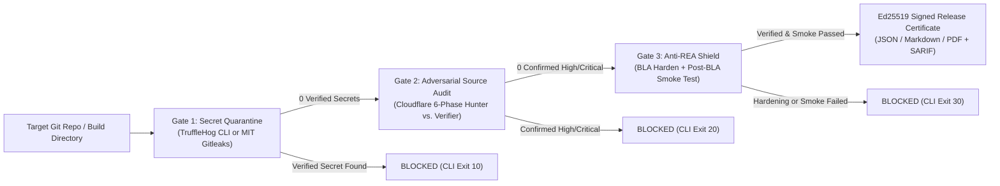

# Bastion — Pre-Ship Security & Anti-AI-Reverse-Engineering Release Gate

Bastion (`v2.1.0`) is a local-first DevSecOps web application, REST API, and headless CLI orchestrator that enforces a sequential **3-stage Pre-Ship Release Gate** against any local Git repository or build directory before code ships.

Every run streams real-time execution logs over Server-Sent Events (SSE), persists full audit history and additive coverage ledgers in SQLite, exports SARIF v2.1.0 for GitHub Code Scanning, and issues an asymmetrically signed **Ed25519 Release Certificate** (JSON, Markdown, and PDF).

---

## Architecture & 3-Stage Release Pipeline



### Gate 1 — Secret Quarantine (Pluggable External CLI)
- Invokes external user-installed secret scanners via a clean `SecretScanner` plugin interface (`backend/app/services/scanners/`) with zero vendored AGPL code.
- Supports **TruffleHog** (`trufflehog filesystem` / `trufflehog git`) and **Gitleaks (MIT)**, normalizing both into identical Bastion finding records (detector, file, line, redacted match, verified status).
- Automatically halts the pipeline and fails with exit code `10` if any verified live secret is detected.

### Gate 2 — Adversarial Source Audit (Cloudflare Security Audit Workflow)
- Implements the 6-phase workflow and strict schema validators (`validate-findings.cjs`, `validate-coverage-ledger.cjs`) from Cloudflare's MIT-licensed `security-audit-skill`.
- **Genuine Dual-Session LLM Isolation (BYOK):** Supports **Google Gemini**, **Anthropic Claude**, **OpenAI**, and **Local Ollama** (`http://localhost:11434`).
  - **Session A (Hunter):** Inspects scoped files under the Cloudflare rubric and proposes candidate vulnerability hypotheses.
  - **Session B (Verifier):** Receives *only* raw line-numbered code slices and hypothesis claims (never Session A's chain-of-thought) to independently confirm, downgrade to `needs_validation`, or reject each candidate.
  - When no LLM is configured, explicitly badges Gate 2 everywhere as **`Static Heuristic Fallback (No LLM)`**.
- **Git-Diff Scoping & Token/Cost Budgeting:**
  - `diff` mode (default for PR/CI): audits files changed since `--base <ref>` plus local staged/untracked files and 1-hop direct local imports; marks unchanged files `out_of_scope` in `coverage-ledger.json`.
  - `full` mode: audits the full repository for major releases.
  - Pre-flight token estimation and spend caps (default `$1.50` / `120,000` input tokens) prioritize security-critical paths first (`auth`, `middleware`, `routes`, `api`, `sql`/`orm`, `crypto`, `exec`/`subprocess`) and cleanly record skipped low-risk files as `deferred` in the coverage ledger.
- **Live LLM Resilience:** Strips markdown fences, comments, and trailing commas defensively and runs a 1-shot strict schema-repair retry on malformed JSON responses.

### Gate 3 — Anti-REA Build Hardening (BLA + Post-BLA Smoke Verification)
- Auto-discovers build outputs (`dist/`, `build/`, `.asar`, `.wasm`, `.py`/`.pyc`, native binaries, `.safetensors`/`.gguf`).
- Runs `bla` (`bla-agents`) `audit -> protect -> verify` into an isolated `.bla-hardened/` mirror without mutating source files, reporting before/after sizes, defense scores, and LLM token/cost amplification.
- **Post-BLA Smoke Verification Hook:** Optionally executes a project `smoke_test_cmd` (or `--smoke-cmd`) against an isolated copy overlaid with `.bla-hardened/` with sensitive environment variables stripped. Fails Gate 3 (exit code `30`) and warns before `--apply` if obfuscation broke runtime boot.
- One-click **`--apply`** (promote hardened mirror to release) and **`--restore`** (instant rollback).

### Security & Attestation Foundations
- **Encrypted BYOK Secret Vault (`vault.py`):** All persisted LLM API keys are encrypted with authenticated Fernet (`enc:fernet:v1:`) using a host-local master key outside the repo at `~/.bastion/keys/vault.key` (`0600` on POSIX, current-user ACL on Windows). Environment variables always override vault entries. Loaded keys are scrubbed from SSE logs, tracebacks, and exported certificates.
- **Asymmetric Ed25519 Release Certificates (`certificate.py`):** Auto-generates `~/.bastion/keys/ed25519_private.pem` and `ed25519_public.pem`. Certificates embed key fingerprint, canonical SHA-256 digest, expiry window, and Ed25519 signature; verifiable offline via `bastion verify` or drag-and-drop in the Compliance Reports UI.

---

## Web Application Views

1. **Overview Dashboard:** Project selector, Release Readiness Score ring, Gate 1 scanner / Gate 2 scope (`diff` | `full`) / Base Ref / Budget / Profile / BLA intensity launch controls, 3-stage pipeline visualizer, recent run history, and one-click **CI/CD Setup** modal.
2. **Pipeline Runner:** Live SSE streaming terminal with real-time stage progress indicators, token/cost telemetry, and abort/retry controls.
3. **Findings & Triage:** Filterable unified table across Gate 1 and Gate 2 findings with severity/verdict calibration (`Confirmed`, `Needs Validation`, `Hardening Note`), inline source code context viewer, remediation diffs, triage resolution notes, and SARIF v2.1.0 export.
4. **Artifact Shield (BLA):** Discovered artifact inventory, defense scores, token/cost amplification metrics, intensity selector (`stealth` | `balanced` | `maximum` | `bankrupt`), Post-BLA Smoke Verification runner, and `--apply` / `--restore` controls with pre-apply failure guard.
5. **Compliance Reports:** Run history, signed Ed25519 JSON/Markdown/PDF certificate exports, drag-and-drop cryptographic tamper & expiry verifier, and cross-run additive coverage ledger table.
6. **Settings & Toolchain Drawers:** Fernet encrypted vault BYOK LLM configuration (`ENV Override` vs. `Encrypted Vault` badges, masked keys, connection test) and live host toolchain diagnostics.

---

## Prerequisites

- **Python** `3.11+`
- **Node.js** `20+` (LTS 22 recommended) and `npm`
- **Git** `2.30+`
- External security engines (installed automatically by `setup.ps1` / `setup.sh`, with graceful simulation fallback if absent):
  - **TruffleHog** (`trufflesecurity/trufflehog`) and/or **Gitleaks** (`gitleaks/gitleaks`, MIT)
  - **BLA** (`npm install -g bla-agents`)
  - **Cloudflare Security Audit Skill** (vendored under `vendor/security-audit-skill/`, MIT)

---

## Quick Start (Local Development)

### 1. Clone the Repository

```bash
git clone https://github.com/xity4uu-a11y/bastion.git
cd bastion
```

### 2. Optional: Install External Security Engines

**Windows (PowerShell):**
```powershell
.\setup.ps1
```

**macOS / Linux:**
```bash
chmod +x setup.sh && ./setup.sh
```

### 3. Setup & Start the Backend (Port 8000)

**Windows (PowerShell):**
```powershell
cd backend
python -m venv .venv
.\.venv\Scripts\pip install -r requirements.txt
.\.venv\Scripts\pip install -e .
.\.venv\Scripts\python.exe -m uvicorn app.main:app --host 127.0.0.1 --port 8000
```

**macOS / Linux:**
```bash
cd backend
python3 -m venv .venv
./.venv/bin/pip install -r requirements.txt
./.venv/bin/pip install -e .
./.venv/bin/python -m uvicorn app.main:app --host 127.0.0.1 --port 8000
```

### 4. Setup & Start the Frontend (Port 3000)

Open a second terminal:

**Windows (PowerShell):**
```powershell
cd frontend
npm.cmd install
npm.cmd run dev
```

**macOS / Linux:**
```bash
cd frontend
npm install
npm run dev
```

Open **http://localhost:3000** in your browser. A pre-configured sample project (`sample-target/`) is seeded automatically so you can test all three gates immediately.

---

## Headless CLI Usage

Once `pip install -e .` has run inside `backend/`, the `bastion` CLI is available in your virtual environment (`backend/.venv/Scripts/bastion.exe` on Windows or `backend/.venv/bin/bastion` on macOS/Linux).

### Strict CI/CD Exit Codes

| Exit Code | Meaning |
| ---: | --- |
| `0` | All 3 gates passed — Ed25519 Release Certificate approved |
| `10` | Blocked at **Gate 1** — verified live secret detected |
| `20` | Blocked at **Gate 2** — confirmed high or critical vulnerability detected |
| `30` | Blocked at **Gate 3** — BLA hardening, verification, or post-BLA smoke test failed |

### Common CLI Commands

```bash
# Inspect installed external plugins, Cloudflare validators, and Ed25519 key fingerprint
bastion doctor

# Run 3-stage release gate (PR diff scope, $1.50 cap, post-BLA smoke test, SARIF + Ed25519 cert)
bastion run ./sample-target \
  --scanner auto \
  --scope diff \
  --base origin/main \
  --max-budget-usd 1.50 \
  --profile standard \
  --intensity balanced \
  --smoke-cmd "node dist/index.js" \
  --sarif-out bastion.sarif \
  --cert-out bastion-cert.json

# Run full repository audit (e.g., before a major release tag)
bastion run ./sample-target --scope full --profile deep --cert-out release-cert.pdf

# Verify an Ed25519-signed Release Certificate offline (detects tampering & expiry)
bastion verify bastion-cert.json --pubkey ~/.bastion/keys/ed25519_public.pem

# Promote hardened .bla-hardened/ outputs to release or roll back cleanly
bastion bla-apply ./sample-target --intensity balanced
bastion bla-restore ./sample-target
```

---

## Docker & Production CLI Container

### Full Stack (Backend + Frontend) with Docker Compose

```bash
docker compose up --build
```
- Frontend UI: `http://localhost:3000`
- Backend API: `http://localhost:8000`

### Production Headless CLI Container (`Dockerfile.cli`)

`Dockerfile.cli` builds a minimal, multi-stage, non-root (`bastion`, UID `10001`) container with Python 3.11 + `bastion` CLI, Node.js 22 LTS (`bla-agents` + Cloudflare validators), and **MIT-licensed Gitleaks** as the default AGPL-clean Gate 1 scanner.

```bash
# Build default AGPL-clean image (Gitleaks MIT)
docker build -f Dockerfile.cli -t bastion-cli:2.1.0 .

# Optional: opt in to external TruffleHog binary at build time
docker build -f Dockerfile.cli --build-arg INSTALL_TRUFFLEHOG=true -t bastion-cli:2.1.0-th .

# Run against the current repository
docker run --rm \
  -v "$(pwd):/workspace" \
  -e GEMINI_API_KEY="$GEMINI_API_KEY" \
  bastion-cli:2.1.0 run /workspace \
    --scope diff \
    --scanner gitleaks \
    --sarif-out /workspace/bastion.sarif \
    --cert-out /workspace/bastion-cert.json
```

---

## GitHub Actions CI/CD Integration

Click **CI/CD Setup** on the Overview Dashboard to copy or download a project-tailored `.github/workflows/bastion-gate.yml` in either **Published Container** (`ghcr.io/<org>/bastion-cli:latest`) or **Self-Built** (`./Dockerfile.cli`) mode.

Key workflow capabilities:
- Passes optional BYOK secrets (`GEMINI_API_KEY`, `ANTHROPIC_API_KEY`, `OPENAI_API_KEY`) strictly via environment variables.
- Runs `bastion run /workspace --scope diff --base origin/${{ github.base_ref }} --scanner gitleaks`.
- Uploads `bastion.sarif` to **GitHub Code Scanning** via `github/codeql-action/upload-sarif@v3`.
- Uploads `bastion-cert.json` + `ed25519_public.pem` via `actions/upload-artifact@v4`.
- Fails pull request checks cleanly on exit codes `10`, `20`, or `30`.

---

## Configuration & Environment Variables

Copy `.env.example` to `.env` for local defaults. **Environment variables always take precedence over local Fernet vault entries** so CI/CD jobs never read host disk secrets.

| Variable | Default | Description |
| --- | --- | --- |
| `GEMINI_API_KEY` | *(empty)* | Google Gemini BYOK API key (overrides vault) |
| `ANTHROPIC_API_KEY` | *(empty)* | Anthropic Claude BYOK API key (overrides vault) |
| `OPENAI_API_KEY` | *(empty)* | OpenAI BYOK API key (overrides vault) |
| `OLLAMA_BASE_URL` | `http://localhost:11434` | Local Ollama server URL (overrides vault) |
| `BASTION_LLM_PROVIDER` | `none` | Active Gate 2 provider: `none`, `gemini`, `anthropic`, `openai`, `ollama` |
| `BASTION_LLM_MODEL` | *(provider default)* | Override model identifier |
| `BASTION_DEFAULT_SECRET_SCANNER` | `auto` | Gate 1 engine: `auto`, `gitleaks`, `trufflehog` |
| `BASTION_DEFAULT_AUDIT_SCOPE` | `diff` | Default Gate 2 scope: `diff` or `full` |
| `BASTION_DEFAULT_MAX_BUDGET_USD` | `1.50` | Max estimated LLM spend per run (USD) |
| `BASTION_DEFAULT_MAX_INPUT_TOKENS` | `120000` | Hard pre-flight input token cap per run |
| `BASTION_SMOKE_TEST_TIMEOUT_SECONDS` | `30` | Timeout for Post-BLA smoke test execution |
| `BASTION_KEYS_DIR` | `~/.bastion/keys` | Directory storing `ed25519_*.pem` and `vault.key` outside repos |
| `BASTION_CERTIFICATE_TTL_DAYS` | `30` | Validity period for signed Ed25519 Release Certificates |

---

## Key REST API Endpoints

| Method | Endpoint | Purpose |
| --- | --- | --- |
| `GET` | `/api/health` | Service health and version (`2.1.0`) |
| `GET` | `/api/system/tools` | Live/fallback status for TruffleHog, Gitleaks, Cloudflare skill, BLA, Node, Git |
| `GET` | `/api/system/public-key` | Host Ed25519 public key PEM and fingerprint |
| `GET` / `PUT` | `/api/settings/llm` | Read masked secret metadata (`configured`, `source`, `masked_key`) or update encrypted vault |
| `POST` | `/api/settings/llm/test` | Probe configured BYOK LLM provider connectivity |
| `GET` / `POST` | `/api/projects` | List or register target local repositories |
| `PATCH` / `DELETE` | `/api/projects/{id}` | Update scanner, profile, intensity, or `smoke_test_cmd` |
| `POST` | `/api/projects/{id}/bla/smoke-test` | Execute Post-BLA smoke verification against `.bla-hardened/` |
| `POST` | `/api/projects/{id}/bla/apply` | Promote `.bla-hardened/` mirror to release outputs |
| `POST` | `/api/projects/{id}/bla/restore` | Roll back promoted outputs to original build |
| `GET` | `/api/projects/{id}/cicd/github-actions` | Generate runnable `.github/workflows/bastion-gate.yml` (`mode=container\|self-built`) |
| `POST` | `/api/runs` | Launch a 3-stage release gate run |
| `GET` | `/api/runs/{id}/stream` | Server-Sent Events (SSE) real-time log and stage progress stream |
| `GET` | `/api/runs/{id}/certificate?format=json\|md\|pdf` | Export Ed25519-signed Release Certificate |
| `POST` | `/api/certificates/verify` | Cryptographically verify Ed25519 signature, tamper integrity, and expiry |
| `GET` | `/api/findings/export/sarif` | Export SARIF v2.1.0 for GitHub Code Scanning |

---

## Running Tests & Verification

### Backend End-to-End Tests (`pytest`)
```bash
cd backend
./.venv/bin/python -m pytest -v tests/test_bastion_e2e.py
```
Covers the live 3-stage pipeline, SSE streaming, Ed25519 tamper & expiry detection, Hunter vs. Verifier LLM isolation, Fernet vault raw-SQLite encryption & env precedence, git-diff scoping + budget capping, malformed LLM JSON repair retry, Post-BLA smoke verification (including CLI exit `30`), and dual-mode GitHub Actions YAML parsing.

### Frontend Typecheck & Production Build
```bash
cd frontend
npm run typecheck
npm run build
```

---

## Project Structure

```text
bastion/
├── backend/
│   ├── app/
│   │   ├── cli.py                 # Typer CLI (doctor, run, verify, bla-apply, bla-restore)
│   │   ├── config.py              # Pydantic settings & paths
│   │   ├── database.py            # SQLite WAL + secure_delete + additive migrations
│   │   ├── main.py                # FastAPI entrypoint & startup vault migration
│   │   ├── models.py              # SQLAlchemy ORM models
│   │   ├── schemas.py             # Request/response schemas
│   │   ├── routers/               # projects, runs, findings, system/settings/certificates
│   │   └── services/
│   │       ├── scanners/          # Pluggable SecretScanner interface (TruffleHog, Gitleaks, Fallback)
│   │       ├── gate1_trufflehog.py
│   │       ├── gate2_cloudflare.py # Diff/full scoping, budgeting, Hunter+Verifier LLM, Cloudflare validators
│   │       ├── gate3_bla.py       # BLA audit/protect/verify + Post-BLA smoke test hook
│   │       ├── vault.py           # Fernet encrypted secret vault & log/report scrubbing
│   │       ├── keys.py            # Asymmetric Ed25519 keypair management
│   │       ├── certificate.py     # JSON, Markdown, and PDF Release Certificates + verifier
│   │       ├── cicd.py            # Dual-mode GitHub Actions workflow generator
│   │       ├── sarif.py           # SARIF v2.1.0 exporter
│   │       └── event_bus.py       # Scrubbed SSE pub/sub stream
│   ├── tests/test_bastion_e2e.py  # 10 end-to-end automated tests
│   └── pyproject.toml
├── frontend/
│   └── src/
│       ├── app/                   # Next.js App Router + Apple-minimalist light/dark theme tokens
│       ├── components/            # Overview, PipelineRunner, Findings, ArtifactShield, Compliance, Settings, CicdModal
│       └── lib/                   # Typed API client & domain types
├── sample-target/                 # Built-in sample repository with dist/ artifacts for testing
├── vendor/security-audit-skill/   # Cloudflare MIT security-audit-skill rubric & Node schema validators
├── Dockerfile.cli                 # Multi-stage non-root AGPL-clean CLI container
├── docker-compose.yml             # Local full-stack container setup
├── setup.ps1 / setup.sh           # One-click external toolchain installers
├── .env.example                   # Documented environment variables
└── LICENSE                        # MIT License
```

---

## License & Attribution

- **Bastion** is released under the [MIT License](LICENSE).
- Incorporates Cloudflare's `security-audit-skill` rubric and Node.js schema validators under the MIT License (`vendor/security-audit-skill/LICENSE`).
- Integrates with user-installed external CLI tools (**TruffleHog**, **Gitleaks**, and **BLA / `bla-agents`**) strictly via subprocess plugin invocation.
